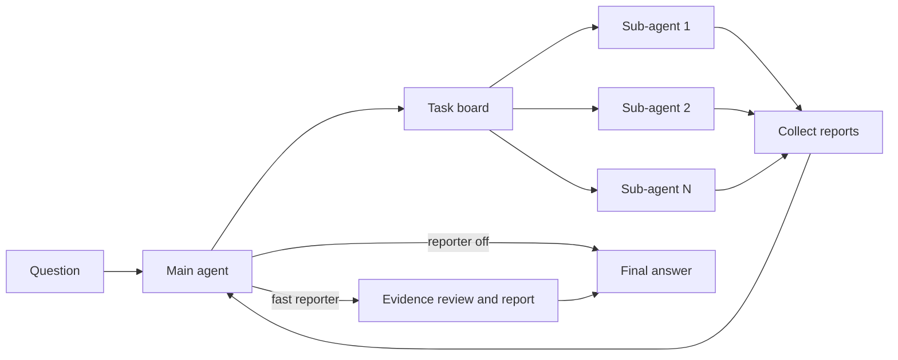

# Agent Team

`agent_team` uses a coordinator to plan research, dispatch parallel sub-agents,
collect their reports, and synthesize a final answer. Reporting is either off or
handled by the `fast` backend.

## Architecture



The main agent communicates with sub-agents through `AgentBus`. `SpawnGuard`
enforces depth, parallelism, and wall-time limits. Sub-agents can search the web,
read files, use the task sandbox, and submit structured reports; they cannot spawn
another team unless the runtime budget explicitly permits it.

## BCG multi-agent memory

BCG is the context implementation in all Agent Team profiles. Each coordinator
and dispatched **job** owns an independent graph. Reusing a specialist session
does not combine its different jobs into one graph. The existing Graph server
can serve all graphs, but this workflow keeps a separate cross-graph index.

Before each model call, preserve the actual human inputs/current assignment and
two recent **complete assistant/tool steps**, including all parallel results.
Older steps are omitted only after successful graph acknowledgement. Retained
provider reasoning blocks are not rewritten. Only readable reasoning is sent
to construction, never encrypted reasoning/signatures. On graph failure, the
full original context is used and the next two distinct requests skip retries.

Automatic reports carry trusted host-origin metadata. They can age into graph
memory after the agent has had an opportunity to read them. Text resembling a
report in a real human input is still permanently pinned. The task board and
current AgentBus job states are injected separately as authoritative runtime
state, not inferred from confidence. Other runtime nudges remain conservative
pinned inputs; this version does not rewrite the generic loop's intervention API.

### Connections between graphs

| Link | Meaning | Creation |
|---|---|---|
| `delegates_to` | A parent's `assign_task` belief leads to the child's task-entry beliefs | Runtime call ID + job ID, bound when both graphs have the nodes |
| `reports_from` | A received report batch originates from particular child report beliefs | Actual collected job IDs, not text matching on agent names |
| `depends_on`, `supplements`, `contradicts` | An explicit semantic assessment between beliefs in different graphs | Agent calls `bcg_team_link`; only its own source graph can be written |

References include a logical graph ID, belief ID, server problem ID and snapshot
revision. Pending links are valid while recent messages have not yet entered
the graph. A merged belief is resolved through `merged_from`. A server rebuild
invalidates old semantic edges instead of retargeting numeric IDs silently.
Delegation/provenance links are recomputed from the acknowledged ledger.

`submit_report`'s body is exposed to semantic extraction in addition to the
unchanged tool-call JSON. Before returning a report, the child attempts to flush
its remaining turns and appends references to the report's belief nodes. Graph
failure does not discard the report. Report IDs are unavailable until export
succeeds. This handoff flush can add latency; it has its own usage boundary.

The coordinator receives the full report through the normal fan-in path. After
it ages out, a bounded selection of linked report beliefs is automatically
included in system memory. It is not duplicated while the full report is still
retained. Deeper evidence is read on demand, not copied wholesale into every
agent's prompt.

### Tools

- `bcg_recover(belief_id, offset=0, limit=4000)`: original source from your own graph.
- `bcg_team_status(offset=0, limit=4000)`: registered graph IDs, actual job states, pending/bound links, and usage.
- `bcg_team_read(graph_id, belief_id, depth=1, include_source=false, offset=0, limit=4000)`: inspect a colleague's belief and its evidence chain. Depth is capped at 3 and traversal at 24 nodes. Each read returns at most 8,000 body characters and a continuation offset.
- `bcg_team_link(belief_id, target_graph, target_belief_id, relation_type, note="")`: record an explicit semantic relation from an existing local belief to an existing remote belief. It does not verify the model's judgment or change confidence.
- `assign_task(... belief_refs=["graph_id:B123"])`: pass validated, budgeted evidence references with a task. Unknown references fail before dispatch. Existing sandbox and publication permissions are unchanged.

Cross-graph tools can only access graphs registered in the current team
conversation. They cannot open arbitrary paths, query unrelated server graphs,
or modify a colleague's graph. Runtime states are available without a graph
model request. Reporter remains a bounded evidence-review/writing pass, not a
separate rolling BCG agent.

### Configuration and launch

Start a compatible BCG Graph server separately. Its graph-model key/configuration
stays in that service. The Agent's `OPENAI_*` settings remain separate.

```bash
export BCG_GRAPH_URL=http://127.0.0.1:8850
export BCG_RECENT_TURNS=2
export BCG_GRAPH_CHARS=6600
export BCG_TEAM_CROSS_GRAPH_CHARS=2000
export BCG_GRAPH_TIMEOUT=120
uv run frontier-agent --mode agent_team
```

The 6,600-character graph budget is **shared**, not doubled: by default 4,600
characters for the selected local graph and 2,000 for linked remote beliefs.
Original system instructions, guidance, task-board/runtime state and verbatim
recent messages are outside this graph-content budget. The runtime overview
shows up to 20 jobs; the status tool exposes the full paginated index. The model
and graph service do not have to use the same provider. `BCG_GRAPH_API_KEY`, if
set, authenticates the graph HTTP endpoint, not the graph model.

### Records and verification

Interactive records live under `$APODEX_RUN_DIR/bcg_team/`. Benchmark records
live under the run's trajectory directory, e.g.
`<trial>/agent/trajectories/bcg_team/`.

```text
bcg_team/
  index.json                 graph ownership, job state, cross-graph links
  g_<id>/state.json          acknowledged turns, graph snapshot, recoverable sources
  g_<id>/requests.jsonl      local selection, injected cross-graph context, failures, usage
```

The graph server also keeps its own construction outputs. Local indexes and
checkpoints use owner-only file permissions. The ordinary full trajectories
remain available. `online_graph_usage` records usage before the tail flush;
`graph_usage` includes it. Construction usage is not relabelled as Agent tokens.

The offline integration test in `tests/test_team_bcg.py` runs the real
coordinator, AgentBus and dispatch/report tools with two parallel specialists,
but uses deterministic model/graph doubles. It verifies isolation, graph
projection, report references and cross-graph reads. It is **not** a benchmark
accuracy, latency or token-saving result.

Current boundaries: no cross-graph confidence propagation, no automatic global
semantic edge inference, no claim-level alignment inside a batch report, no
global deduplication of independently extracted evidence, and no multi-graph
dashboard changes. Semantic links are model assertions with provenance, not
verified evidence. The cross-graph index lives in FrontierAgent, not in the
existing graph service's local edge table. Restarting the terminal can reload
recorded graphs, but does not resume cancelled remote jobs automatically.

## Loop guardrails

Three profile keys arm the reasoning-runaway watchdog; absent or `0` leaves each
one off.

| Key | Shipped value | Effect |
|---|---:|---|
| `reasoning_only_timeout_s` | 120 | Abort a streamed reply that has produced only reasoning for this long |
| `reasoning_only_max_tokens` | 16384 | Abort it at this many estimated reasoning tokens |
| `logical_call_timeout_s` | 900 | Bound one logical LLM call across admission wait, every physical attempt, and retry backoff |

Setting either `reasoning_only_*` key puts the loop on the streaming request
path, which is the only place the watchdog can see reasoning arrive. Protocols
that never stream (`anthropic`, `responses`, `bedrock`) ignore all three; the
post-hoc reduced-cap resample remains the floor there.

Repetition stop-loss is observer-side:

| Observer | Signal | Action |
|---|---|---|
| `DuplicateQueryRollbackObserver` | A `web_search` request already executed in this loop **and returned content** | Pops the turn before the search runs and re-samples, without spending a `max_turns` slot. Never pops a batch carrying a terminal tool |
| `RepetitionGuard` | Consecutive turns with byte-identical tool calls | Hint at 3; stop at `stop_after` where stopping is affordable |
| `TextRepetitionGuard` | Near-verbatim assistant prose across turns | Hint, then stop where stopping is affordable |

`RepetitionGuard` is the only one of the three that can end a loop whose
repetition lives entirely in the tool channel: the rollback's budget expires
into permanent let-through, and `TextRepetitionGuard` needs visible prose,
which a `thinking_format: tag` model does not produce while looping. Its
`stop_after` is therefore enabled wherever a truncated run is recoverable.

The reasoning token cap is load-invariant; `reasoning_only_timeout_s` is wall
clock and its token-equivalent shrinks as endpoint concurrency rises. Trust
the token cap when tuning.

`RepetitionGuard` is deliberately absent from the coordinator: waiting on
running sub-agents means calling `collect_reports` repeatedly with identical
arguments. `NoProgressGuard` owns the coordinator's own spin pathology
(repeated `create_subagent` / `assign_task` with no work coming back).

## Profiles

| Profile | Use | Web implementation | Reporter default | Planning |
|---|---|---|---:|---:|
| `simple` | Basic BCG team | Search: original; fetch: aligned | Pipeline-selected | Off |
| `benchmark` | Reproducible evaluation | Search: original; fetch: aligned | Pipeline-selected | Off |
| `tui` | Interactive TUI | Original | Off | Off |

Set `agent.reporter: false` to route the coordinator directly to the terminal
answer. The YAML files contain comments for every group of model, budget,
BCG memory, planning, and tool settings; start with
[`profiles/simple.yaml`](profiles/simple.yaml),
[`profiles/benchmark.yaml`](profiles/benchmark.yaml), or
[`profiles/tui.yaml`](profiles/tui.yaml) when creating an override.

## Why some names say `swarm`

`swarm` was this subsystem's original name. Nothing called `swarm` exists any
more — this repository has exactly two workflows, `agent_team` and
`stateful_react_agent` — but the word survives on identifiers that other things
bind to, and renaming those would break them rather than tidy them:

| Name | Why it cannot move |
| --- | --- |
| `response.swarm.*` | SSE event namespace consumed by clients |
| `logs/swarm/<task_id>/` | on-disk trajectory layout for standalone runs |
| `swarm_main` | role id peer nodes resolve LLMs by |
| `load_swarm_profile`, `create_swarm_llm`, `build_swarm_session_runtime_spec`, `SwarmSubagentRuntime`, `_swarm_observers` | the profile schema and runtime seam that `plugins/tools/create_subagent.py` imports by name |

So: `swarm` in an identifier means "this workflow, named historically". Comments
and docstrings say `agent_team`. One user-visible string still reads `swarm done`
in the console observer.

`create_subagent` keeps a second naming mode — strict `{topic}_{task_type}[_N]`
sub-agent names, enabled by a workflow declaring `SUBAGENT_TASK_TYPES` in its
prompts module. No workflow here declares it, so that path is an extension seam,
not a live branch; `agent_team` uses free-form role labels.

## Run

For DeepResearch Bench II and DRBench report tasks, use the
[BCG report benchmark runner](../../benchmarks/public/reports/README.md). It
applies the same task-specific retrieval restrictions to the coordinator and
specialists and saves full reports with the existing multi-graph records.

```bash
uv sync --extra eval --extra sandbox --extra document-readers
cp .env.example .env

# Coordinator + sub-agents, reporter off.
uv run python -m benchmarks.public.runner.run_subprocess \
  --benchmark browsecomp --pipeline agent_team --profile benchmark \
  --limit 1 --concurrency 1 --out ./results/agent-team-smoke

# Same team with the fast reporter.
uv run python -m benchmarks.public.runner.run_subprocess \
  --benchmark browsecomp --pipeline agent_team_report \
  --profile benchmark --limit 1 --concurrency 1 \
  --out ./results/agent-team-report-smoke
```

Each benchmark worker is isolated in its own subprocess. Total possible model
parallelism is roughly benchmark `--concurrency` multiplied by the sub-agent
parallelism allowed by `SpawnGuard`, so start with concurrency 1.

Set `SWARM_NO_WEB=1` for closed-book tasks. File-aware tasks should also pass
`--fs-mode`; the benchmark runner then supplies the sandbox metadata and mounts.

## Configuration boundaries

- Profiles select prompts, tools, turn budgets, BCG budgets, and reporter behavior.
- `frontier_agent/` owns the generic loop, observers, registries, and AgentBus.
- `plugins/tools/` owns tool implementations and sandbox policy.
- `benchmarks/` is a consumer and is never imported by the framework.

The reporter is fail-open after the coordinator has produced an answer: a fast
reporter failure preserves that answer. Sandbox setup and command authorization are
fail-closed; they never fall back to unisolated host execution.
