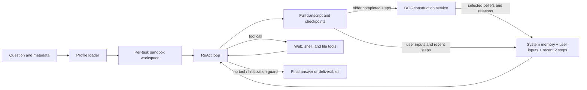

# Stateful ReAct Agent

`stateful-react-agent` runs one ReAct agent in a per-task workspace. It is the
default pipeline for the single-agent benchmark families, including research and
file benchmarks. It supersedes the removed `react_base` workflow while retaining
web research, mounted-input inspection, and persistent deliverables under
`/outputs`.

## Architecture



The workflow uses the shared `run_agent_loop` kernel with stateful observers for
wall-clock enforcement, BCG memory, repeated-text detection, stuck-target
handling, and final-answer recovery. A no-tool assistant response is terminal.

## BCG memory

BCG replaces the old single-agent context retention in **all** ReAct profiles.
There is no original-ReAct/BCG strategy switch. Agent Team uses the same
projection foundation with [independent per-job graphs and cross-graph links](../agent_team/README.md#bcg-multi-agent-memory).

Before each model request:

1. Keep the original system instructions and **every user message**.
2. Keep the **two latest complete steps**, including original provider reasoning
   blocks, tool calls and their results. A step is one assistant response plus
   **all** its parallel tool results, not two individual messages. An unfinished
   tool batch is always retained.
3. Seed the graph with the initial user request once. When an older step leaves
   the window, send its visible reasoning/text and structured tool calls as an
   assistant graph turn, followed by **one batched tool-result graph turn**.
   Original tool names and call IDs are preserved. Ciphertext and reasoning
   signatures are never treated as text for graph extraction.
4. After the service acknowledges the write, call its `focused` graph selector
   using the task and recent steps. Insert the selected original beliefs,
   confidence values and directed relations in a separate **system** message,
   within `<context_blocks_guide>` and `<belief_graph>` blocks. No synthetic
   dialogue or model-specific chat template is used. Confidence is not
   recalculated by FrontierAgent.
5. The model can call `bcg_recover(belief_id=123)` to read a selected belief's
   recorded source turn, including full captured tool output. Long sources are
   paginated. This is read-only, session-scoped historical evidence, not a new
   verification of the current workspace.

The full transcript stays in the local checkpoint. Only the model request is
projected; recent native reasoning/tool-call structures are not rewritten.
Existing tool approvals, sandboxing, duplicate-query rollback, task boards and
`recover_result` continue to operate. BCG preparation normally runs before the
model's first-token watchdog, with graph requests bounded by their own timeout.

Graph failure, an invalid/empty selection, or unsupported multimodal history
causes a **full-context fallback**, recorded in the audit log. History is never
dropped before acknowledgement. A lost write acknowledgement, a rolled-back
history or a missing graph after server restart creates a fresh graph and
replays the eligible prefix. It never blindly retries an uncertain append to
the same graph. Provider context-length guards still apply during fallback.

### Setup

Run a BCG construction service separately, using its existing model config and
credentials. FrontierAgent does not start a second Agent, change the graph
model, or read keys from a sibling BCG repository. The required service API is
`POST /turns`, `GET /graph`, and `POST /context-selection` with the `focused`
selector and snapshots containing `n_turns_ingested`.

For an installed BCG service, for example (use your existing config path):

```bash
bcg construct server unified --config ~/.bcg/config.yaml \
  --host 127.0.0.1 --port 8850 --output-dir ~/.bcg/graphs
```

Set these in FrontierAgent's `.env` alongside the existing `OPENAI_*` Agent
settings and, for web search, `SERPER_API_KEY`:

```dotenv
BCG_GRAPH_URL=http://127.0.0.1:8850
BCG_RECENT_TURNS=2
BCG_GRAPH_CHARS=6600
BCG_GRAPH_TIMEOUT=120
BCG_GRAPH_API_KEY=
```

`BCG_GRAPH_API_KEY` is an optional **HTTP gateway bearer token**, not the graph
model's API key. Leave it empty for the standard local BCG server. Graph model
credentials remain in the BCG service configuration. The character budget is
for the rendered graph, excluding the fixed guidance. Complete nodes and
incident relations are removed to fit; beliefs are not cut mid-sentence.

Then start the existing ReAct interface:

```bash
uv run frontier-agent --mode react
```

Inside Docker, `127.0.0.1` refers to the container. Set `BCG_GRAPH_URL` to an
address reachable **from that container**, such as a configured host gateway.
Only send private workspace/tool contents to a graph server you trust.

### Records and recovery

Terminal sessions write `bcg/state.json` and `bcg/requests.jsonl` below their
session run directory (`.apodex/runs/<session-id>/` by default). Benchmark tasks
write them under the task's artifact directory, not in a shared global graph.
State includes the graph ID, acknowledged turns, snapshot and captured source
results, with owner-only file permissions. Graph server outputs still live in
the server's configured output directory, under that graph ID.

`requests.jsonl` records selected node/relation IDs, retained transcript indices,
the actual injected memory block, fallback reasons, graph preparation time and
the current graph's cumulative token usage. The standard trajectory stores the
full transcript; it should not be mistaken for the projected wire request.

A completed one-shot task also flushes the remaining tail and final answer to
the graph **after** answering. Its extra graph usage is recorded separately as
`final_graph_flush`, with `online_graph_usage` and `final_graph_usage`. A terminal
session keeps its tail ungraphed until eviction because the user may continue.

Run the offline integration checks without model credentials:

```bash
uv run pytest -q tests/test_react_bcg.py tests/test_stateful_workflow.py
```

## Loop guardrails

Three profile keys arm the reasoning-runaway watchdog; absent or `0` leaves each
one off.

| Key | Shipped value | Effect |
|---|---:|---|
| `reasoning_only_timeout_s` | 120 | Abort a streamed reply that has produced only reasoning for this long |
| `reasoning_only_max_tokens` | 16384 | Abort it at this many estimated reasoning tokens |
| `logical_call_timeout_s` | 900 | Bound one logical LLM call across admission wait, every physical attempt, and retry backoff |

Setting either `reasoning_only_*` key puts the loop on the streaming request
path, which is the only place the watchdog can see reasoning arrive. Protocols
that never stream (`anthropic`, `responses`, `bedrock`) ignore all three; the
post-hoc reduced-cap resample remains the floor there.

Repetition stop-loss is observer-side:

| Observer | Signal | Action |
|---|---|---|
| `DuplicateQueryRollbackObserver` | A `web_search` request already executed in this loop **and returned content** | Pops the turn before the search runs and re-samples, without spending a `max_turns` slot. Never pops a batch carrying a terminal tool |
| `RepetitionGuard` | Consecutive turns with byte-identical tool calls | Hint at 3; stop at `stop_after` where stopping is affordable |
| `TextRepetitionGuard` | Near-verbatim assistant prose across turns | Hint, then stop where stopping is affordable |

`RepetitionGuard` is the only one of the three that can end a loop whose
repetition lives entirely in the tool channel: the rollback's budget expires
into permanent let-through, and `TextRepetitionGuard` needs visible prose,
which a `thinking_format: tag` model does not produce while looping. Its
`stop_after` is therefore enabled wherever a truncated run is recoverable.

The reasoning token cap is load-invariant; `reasoning_only_timeout_s` is wall
clock and its token-equivalent shrinks as endpoint concurrency rises. Trust
the token cap when tuning.

## Profiles

| Profile | Context | Model configuration |
|---|---|---|
| `simple` | BCG + two complete recent steps + all user inputs | `OPENAI_*` |
| `benchmark` | Same BCG context, benchmark budgets/tools | `OPENAI_*` |
| `tui` | Same BCG context, resumable full transcript | `OPENAI_*`, aligned web tools, task board |

Profile configuration is under `agent.bcg`; the shipped values read the
`BCG_*` environment variables above. The retired aliases `keep5` → `benchmark`,
`Apodex1.1-solve` → `tui`, and `default` → `simple` all use BCG too. Old
`keep_last_k` and `context_compaction` keys no longer control ReAct. The aliases
do **not** reproduce the previous baseline's context behavior.

## Run

```bash
uv sync --extra eval --extra sandbox --extra document-readers
cp .env.example .env

uv run python -m benchmarks.public.runner.run_subprocess \
  --benchmark browsecomp --pipeline stateful-react-agent \
  --profile simple --limit 1 --concurrency 1 \
  --out ./results/stateful-smoke
```

For file tasks:

```bash
uv run python -m benchmarks.public.runner.run_subprocess \
  --benchmark officeqa --pipeline stateful-react-agent \
  --profile benchmark --fs-mode --limit 1 --concurrency 1 \
  --out ./results/officeqa-smoke
```

The runner mounts benchmark inputs read-only at `/inputs`, gives the agent a
per-question `/workspace`, and preserves `/outputs` for grading when the benchmark
requests deliverables.

## Sandbox modes

`SANDBOX_BACKEND=auto` selects bubblewrap when available and otherwise fails with
setup guidance. `bwrap` requires Linux user namespaces. `container` is only safe
when FrontierAgent already runs inside an isolated task container; it must not be
used as an unisolated host fallback. See [framework sandboxing](../../docs/framework.md#sandboxing).

Set `REACT_NO_WEB=1` to remove web tools and `BASH_ALLOWLIST_MODE` to override the
profile's shell command policy. Authorization and sandbox failures are fail-closed.
